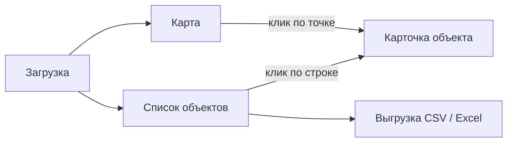

# Дизайн интерфейса

Стадия 4 workflow, сжатая под хакатон. Интерфейс собираем на Streamlit, поэтому вместо макетов в Figma делаем пути пользователя и вайрфреймы прямо здесь. Макеты, дизайн-токены и тесты на людях пропускаем: оформление берём стандартное из Streamlit, а вместо тестов на пользователях показываем интерфейс менторам на чекпоинте.

## Структура приложения

Одна страница Streamlit, навигация вкладками:



Боковая панель (sidebar) видна на всех вкладках: сводка по текущему объезду и фильтры (US8).

## Пути пользователя

| История | Путь |
| ------- | ---- |
| US1 Загрузка | «Загрузка» → выбрать файлы или архив, при наличии — файл трека → «Обработать» → прогресс → сводка обработки → кнопка «Перейти к карте» |
| US2 Детекция | Карточка объекта → кадр с рамкой, классом и уверенностью |
| US3 Состояние | Карточка объекта → статус, тип дефекта, пояснение |
| US4 Привязка | Карта: одна точка на объект; карточка: координаты, их источник, число наблюдений и все кадры |
| US5 Список | «Список объектов» → таблица по убыванию приоритета |
| US6 Карта | «Карта» → точки по статусу → клик → карточка |
| US7 Выгрузка | «Список объектов» → «Скачать CSV» или «Скачать Excel» |

## Вайрфреймы

### Вкладка «Загрузка»

```
┌──────────────┬───────────────────────────────────────────────────┐
│ ОБЪЕЗД       │  [Загрузка]  Карта   Список объектов              │
│ кадров: —    ├───────────────────────────────────────────────────┤
│ объектов: —  │  Кадры объезда                                    │
│ дефектов: —  │  ┌─────────────────────────────────────────────┐  │
│              │  │  Перетащите JPG, PNG или ZIP сюда           │  │
│ ФИЛЬТРЫ      │  │  или [Выбрать файлы]                        │  │
│ (неактивны   │  └─────────────────────────────────────────────┘  │
│  до загрузки)│  GPS-трек (необязательно): [Выбрать CSV/GPX]      │
│              │                                                   │
│              │  [ Обработать ]                                   │
│              │                                                   │
│              │  ── после обработки ──────────────────────────    │
│              │  Обработано 412 кадров за 2 мин 31 с              │
│              │  ⚠ 3 файла пропущены: не изображения  [подробнее] │
│              │  ⚠ 17 кадров без координат            [подробнее] │
│              │  Найдено объектов: 58, из них требуют проверки: 9 │
│              │  [ Перейти к карте → ]                            │
└──────────────┴───────────────────────────────────────────────────┘
```

### Вкладка «Карта»

```
┌──────────────┬───────────────────────────────────────────────────┐
│ ОБЪЕЗД       │   Загрузка  [Карта]  Список объектов              │
│ кадров: 412  ├───────────────────────────────────────────────────┤
│ объектов: 58 │  ┌─────────────────────────────────────────────┐  │
│ дефектов: 6  │  │        ·               ✖                    │  │
│ неясно: 3    │  │   ·         ·    ?                          │  │
│              │  │        ━━━━━━━━━━ трек ━━━━━━━━━━━━         │  │
│ ФИЛЬТРЫ      │  │     ✖        ·            ·     ·           │  │
│ Класс:       │  │                   ·                         │  │
│ ☑ колодец    │  └─────────────────────────────────────────────┘  │
│ ☑ опора      │  Легенда: ✖ дефект   ? не удалось оценить  · норма│
│ Статус:      │                                                   │
│ ☑ дефект     │  ┌ Карточка объекта (по клику на точку) ───────┐  │
│ ☑ неясно     │  │ [кадр с рамкой]   Колодец #23               │  │
│ ☐ норма      │  │                   Статус: ДЕФЕКТ             │  │
│ Приоритет:   │  │                   Тип: смещённая крышка      │  │
│ ☑ высокий    │  │                   Пояснение: крышка сдвинута,│  │
│ ☑ средний    │  │                   виден зазор у края люка    │  │
│ ☐ низкий     │  │                   Приоритет: высокий         │  │
│              │  │                   55.7512, 37.6184 (EXIF)    │  │
│              │  │                   Наблюдений: 4  [все кадры] │  │
│              │  └─────────────────────────────────────────────┘  │
└──────────────┴───────────────────────────────────────────────────┘
```

Статус обозначаем и цветом, и формой значка, и подписью: так карту можно читать и при плохом различении цветов.

### Вкладка «Список объектов»

```
┌──────────────┬───────────────────────────────────────────────────┐
│ (sidebar     │   Загрузка   Карта  [Список объектов]             │
│  как на      ├───────────────────────────────────────────────────┤
│  карте)      │  Требуют проверки: 9          [Скачать CSV]       │
│              │                               [Скачать Excel]     │
│              │  ┌────┬─────────┬─────────┬────────────┬───────┐  │
│              │  │ ID │ Класс   │ Статус  │ Тип        │ Приор.│  │
│              │  ├────┼─────────┼─────────┼────────────┼───────┤  │
│              │  │ 23 │ колодец │ дефект  │ смещ. крыш.│ выс.  │  │
│              │  │ 41 │ опора   │ дефект  │ наклон     │ выс.  │  │
│              │  │ 07 │ колодец │ неясно  │ —          │ сред. │  │
│              │  │ ...                                         │  │
│              │  └─────────────────────────────────────────────┘  │
│              │  Клик по строке открывает карточку объекта        │
└──────────────┴───────────────────────────────────────────────────┘
```

## Состояния экранов

| Состояние | Что видит пользователь |
| --------- | ---------------------- |
| Нет загруженных данных | На «Карте» и «Списке» подсказка «Загрузите кадры объезда» и кнопка перехода на вкладку загрузки |
| Идёт обработка | Прогресс-бар с числом обработанных кадров; кнопка «Обработать» неактивна |
| Часть файлов не прочиталась | Предупреждение с числом пропущенных файлов и раскрывающимся списком имён |
| Кадры без координат | Предупреждение; такие кадры не попадают на карту, но их объекты есть в списке с пометкой «без координат» |
| Дефектов не найдено | В списке сообщение «Объектов, требующих проверки, не найдено» и ссылка на карту со всеми объектами |
| Модель не загрузилась | Ошибка с текстом причины; обработка не запускается |

## Чек-лист стадии

- [x] У каждой обязательной истории есть путь пользователя
- [x] Продуманы пустые экраны, ошибки и загрузка
- [ ] Макеты для телефона: не нужны, демо проходит на ноутбуке
- [x] Базовая доступность: статус передаётся не только цветом
- [ ] Интерфейс показан ментору на чекпоинте
