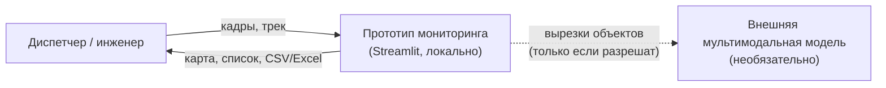
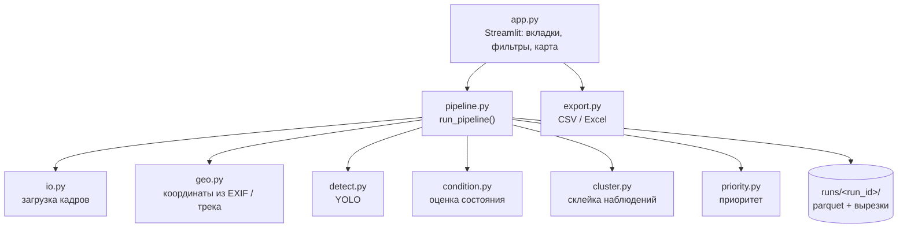
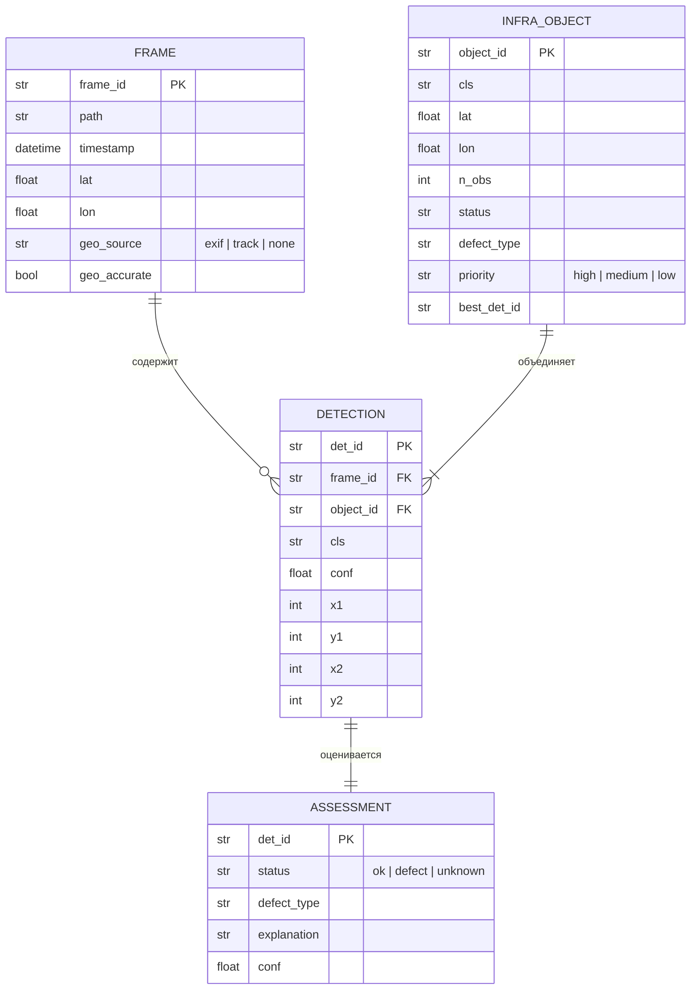

# Design doc: мониторинг инфраструктуры МГТС по фото

Стадия 5 workflow, сжатая под хакатон. Вместо HTTP API и OpenAPI фиксируем контракты между Python-модулями: у нас монолит на Streamlit, и главное, что нужно команде, — договориться о форматах данных, чтобы три человека могли работать параллельно и потом собрать всё без переделок.

## 1. Стек

| Часть | Выбор | Почему |
| ----- | ----- | ------ |
| Язык | Python 3.11 | Команда на нём работает |
| Интерфейс | Streamlit | Опыт в команде, быстрый результат |
| Карта | folium + streamlit-folium | Простая карта с точками и всплывающими карточками |
| Детекция | YOLO (ultralytics) | Опыт в команде, быстрое дообучение |
| Разметка | CVAT или Roboflow + zero-shot предразметка (YOLO-World / Grounding DINO) | Экономит часы ручной разметки |
| Оценка состояния | Открыт, см. ADR-0003 | Зависит от данных и ответа организаторов про внешний API |
| Данные и привязка | pandas, Pillow (EXIF), scikit-learn (DBSCAN) | Опыт в команде |
| Обучение | Google Colab / Kaggle | Бесплатные GPU |

Эксперимент допускаем в одном месте: оценка состояния. Всё остальное — проверенные инструменты.

## 2. Архитектура

### Уровень 1. Система и окружение



### Уровень 2. Части системы

Монолит: одно Streamlit-приложение вызывает пайплайн из модулей. Модули не зависят от Streamlit и запускаются из скрипта или ноутбука, поэтому их можно разрабатывать и проверять без интерфейса.



### Как кадр проходит через систему

1. `io` читает файлы, отбрасывает битые, создаёт записи `Frame`.
2. `geo` заполняет координаты: сначала EXIF, иначе трек по времени, иначе «без координат».
3. `detect` находит объекты на каждом кадре → `Detection`.
4. `condition` оценивает каждую детекцию по вырезке → `Assessment`.
5. `cluster` объединяет детекции одного класса в радиусе R метров → `InfraObject`, статус берётся худший.
6. `priority` считает приоритет объекта.
7. Результат сохраняется в `runs/<run_id>/` и показывается в интерфейсе; `export` формирует файл.

## 3. Данные

Базы данных нет: таблицы pandas в памяти и кэш в parquet на диске. Для хакатона этого достаточно.



Покрытие историй: US1 — `FRAME`; US2 — `DETECTION`; US3 — `ASSESSMENT`; US4 — координаты `FRAME` и склейка в `INFRA_OBJECT`; US5–US7 — `INFRA_OBJECT`.

## 4. Контракты модулей

Это аналог описания API для нашего случая. Сигнатуры фиксируем сейчас; внутренности каждый пишет сам.

```python
# models.py — общие типы, правятся только по договорённости всей команды
from dataclasses import dataclass
from datetime import datetime
from typing import Literal

Status = Literal["ok", "defect", "unknown"]
Priority = Literal["high", "medium", "low"]

@dataclass
class Frame:
    frame_id: str
    path: str
    timestamp: datetime | None
    lat: float | None = None
    lon: float | None = None
    geo_source: Literal["exif", "track", "none"] = "none"
    geo_accurate: bool = False

@dataclass
class Detection:
    det_id: str
    frame_id: str
    cls: str
    conf: float
    bbox: tuple[int, int, int, int]   # x1, y1, x2, y2 в пикселях
    object_id: str | None = None      # заполняет cluster

@dataclass
class Assessment:
    det_id: str
    status: Status
    defect_type: str | None
    explanation: str
    conf: float

@dataclass
class InfraObject:
    object_id: str
    cls: str
    lat: float | None
    lon: float | None
    n_obs: int
    status: Status
    defect_type: str | None
    priority: Priority
    best_det_id: str
```

```python
# io.py
def load_frames(paths: list[str]) -> tuple[list[Frame], list[str]]:
    """Возвращает кадры и список пропущенных файлов с причиной."""

# geo.py
def attach_coords(frames: list[Frame], track: "pd.DataFrame | None",
                  max_dt_s: float = 5.0) -> list[Frame]:
    """track: колонки timestamp, lat, lon."""

# detect.py
def detect(frames: list[Frame], weights: str, conf: float = 0.25) -> list[Detection]: ...

# condition.py
def assess(frames: list[Frame], detections: list[Detection]) -> list[Assessment]: ...

# cluster.py
def merge(frames, detections, assessments, radius_m: float = 10.0) -> list[InfraObject]: ...

# priority.py
def compute_priority(obj: InfraObject, assessments: list[Assessment]) -> Priority: ...

# export.py
def to_csv(objects: list[InfraObject]) -> bytes:  # кодировка utf-8-sig для Excel
def to_xlsx(objects: list[InfraObject]) -> bytes: ...

# pipeline.py
def run_pipeline(paths, track=None, progress=None) -> dict: ...
    # {"frames", "detections", "assessments", "objects", "skipped"}
```

### Кто за что отвечает

| Модуль | Ответственный |
| ------ | ------------- |
| `detect.py`, обучение, разметка | CV-инженер |
| `io.py`, `geo.py`, `cluster.py`, проверка на маршруте | Аналитик данных |
| `app.py`, `export.py` | Разработчик интерфейса |
| `condition.py`, `priority.py`, `pipeline.py` | [не назначен — решить команде] |

Пока соседний модуль не готов, каждый работает на заглушке, которая возвращает данные правильного формата. Например, интерфейс можно делать на `detect()`, выдающей случайные рамки.

## 5. Интеграции

- **Внешняя мультимодальная модель** для оценки состояния — только если организаторы разрешат отправку вырезок. Учесть лимиты и стоимость запросов; кэшировать ответы по `det_id`, чтобы не платить повторно.
- Других внешних сервисов нет.

## 6. Инфраструктура

Приложение запускается локально на ноутбуке для демо. Обучение — в Colab или Kaggle, веса скачиваются по ссылке из README. Окружение одно. Стоимость: 0 ₽, плюс внешний API, если он понадобится.

## 7. Безопасность и персональные данные

- Входа в систему нет: прототип работает локально.
- Ключ внешнего API хранится в `.env` или `st.secrets`, файл в `.gitignore`.
- Кадры и треки не коммитим в публичный репозиторий: на них могут быть лица и номера машин (152-ФЗ). Папки `data/` и `runs/` — в `.gitignore`.
- Во внешний сервис уходят только вырезки объектов, не целые кадры.

## 8. Технические риски

| Риск | Вероятность | План |
| ---- | ----------- | ---- |
| Мало размеченных данных о дефектах | Высокая | Zero-shot предразметка; открытые наборы; оценка состояния через мультимодальную модель вместо обучения классификатора |
| Неточные или отсутствующие GPS | Средняя | Трек по времени; пометка неточных координат; объекты без координат остаются в списке |
| Один объект склеивается в несколько или разные объекты в один | Средняя | Подобрать радиус на проверочном маршруте; склеивать только объекты одного класса |
| Медленная обработка на CPU во время демо | Средняя | Заранее обработанный демо-объезд в `runs/`; лёгкая модель (YOLO n или s) |
| Внешний API запрещён или недоступен на площадке | Средняя | Резервный вариант: локальный классификатор или локальная мультимодальная модель |
| Модули не стыкуются при сборке | Средняя | Контракты из раздела 4 и заглушки с первого часа |

## 9. Решения

Записаны в `docs/adr/`:

- ADR-0001. Монолит на Streamlit без бэкенда и базы данных.
- ADR-0002. Детектор YOLO с zero-shot предразметкой.
- ADR-0003. Подход к оценке состояния (открыт).
- ADR-0004. Склейка наблюдений через DBSCAN по расстоянию.

## Чек-лист стадии

- [x] Стек выбран и записано почему
- [x] Есть диаграмма архитектуры (уровни 1 и 2)
- [x] Данные покрывают все обязательные истории
- [x] Есть описание контрактов модулей вместо API
- [x] Продуманы секреты и персональные данные
- [x] Посчитана стоимость инфраструктуры
- [x] Есть список технических рисков и план по каждому
- [x] Важные решения записаны в ADR
- [ ] Design doc показан ментору или команде для поиска слабых мест
