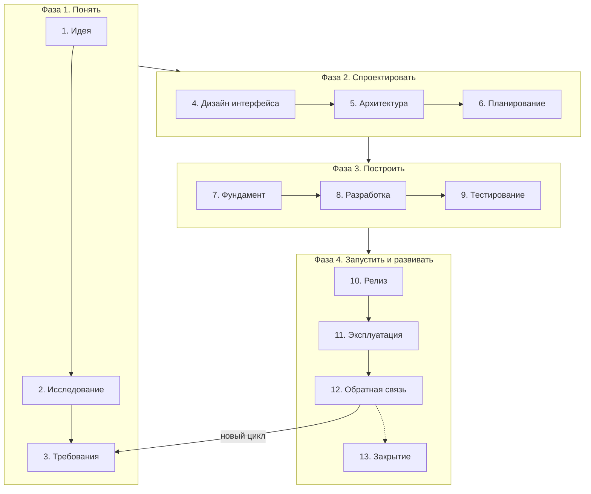

# Workflow разработки приложения

Это рабочая инструкция для любого проекта, от идеи до закрытия. Открой нужную стадию, пройди шаги, отметь пункты чек-листа и переходи дальше.

---

## Содержание

- [Как пользоваться документом](#как-пользоваться-документом)
- [Словарь терминов](#словарь-терминов)
- [Карта стадий](#карта-стадий)
- [Как подстроить процесс под размер проекта](#как-подстроить-процесс-под-размер-проекта)
- [Фаза 1. Понять, что и зачем делаем](#фаза-1-понять-что-и-зачем-делаем)
  - [1. Идея и проблема](#1-идея-и-проблема)
  - [2. Исследование](#2-исследование)
  - [3. Требования и границы проекта](#3-требования-и-границы-проекта)
- [Фаза 2. Спроектировать](#фаза-2-спроектировать)
  - [4. Дизайн интерфейса](#4-дизайн-интерфейса)
  - [5. Архитектура](#5-архитектура)
  - [6. Планирование](#6-планирование)
- [Фаза 3. Построить](#фаза-3-построить)
  - [7. Подготовка фундамента](#7-подготовка-фундамента)
  - [8. Разработка](#8-разработка)
  - [9. Тестирование](#9-тестирование)
- [Фаза 4. Запустить и развивать](#фаза-4-запустить-и-развивать)
  - [10. Релиз](#10-релиз)
  - [11. Эксплуатация и мониторинг](#11-эксплуатация-и-мониторинг)
  - [12. Обратная связь и развитие](#12-обратная-связь-и-развитие)
  - [13. Закрытие проекта](#13-закрытие-проекта)
- [Общие практики](#общие-практики)
- [Шаблоны](#шаблоны)
- [Сводная таблица инструментов](#сводная-таблица-инструментов)

---

## Словарь терминов

Сначала идут подробные разборы главных понятий. Потом короткий справочник по остальным терминам.

### One-pager

**Что это.** Короткий документ на одну страницу. Он отвечает на главный вопрос: что мы делаем, для кого и зачем. С него начинается любой проект.

**Зачем он нужен.**

- Он заставляет чётко сформулировать идею. В голове идея кажется ясной. На бумаге сразу видно слабые места.
- Он помогает решить, стоит ли вообще браться за проект.
- Он не даёт сбиться с курса. Через месяц захочется добавить «ещё одну классную фичу». Сверься с one-pager и проверь, ведёт ли она к цели.
- Его легко показать другому человеку и быстро получить отзыв.

**Что в нём писать.** Проблему, целевую аудиторию, как люди решают проблему сейчас, твоё решение, отличие от конкурентов, метрики успеха, ограничения, личную мотивацию и итоговое решение. Готовый шаблон лежит в разделе [«Шаблоны»](#шаблоны).

**Чего в нём нет.** Это не техническое задание и не список функций. Здесь нет экранов, технологий и деталей реализации. Только суть.

**Пример.**

> - **Проблема:** фрилансеры теряют 10-15% дохода. Они забывают выставлять счета за мелкие задачи и не видят, какие клиенты им невыгодны.
> - **Для кого:** фрилансеры, разработчики и дизайнеры, у которых одновременно от 3 до 10 клиентов.
> - **Как решают сейчас:** таблицы в Excel, заметки в телефоне, тяжёлые CRM.
> - **Наше решение:** Telegram-бот. Пишешь ему одной фразой, что сделал. В конце месяца бот присылает готовые счета и отчёт по выгодности клиентов.
> - **Отличие:** запись занимает 5 секунд, приложение открывать не нужно.
> - **Метрики успеха:** 50 активных пользователей через 3 месяца. 70% продолжают пользоваться через месяц.
> - **Ограничения:** 10 часов в неделю, до 1000 ₽ в месяц на серверы.

---

### Acceptance criteria

**Что это.** По-русски их называют критериями приёмки. Это список конкретных условий. Если все условия выполнены, задача готова. Критерии отвечают на вопрос: как понять, что функция работает правильно?

**Зачем они нужны.**

- Все одинаково понимают слово «готово»: разработчик, тестировщик и заказчик.
- Они задают границы задачи. Без них задачу легко доделывать бесконечно.
- Из них прямо получаются тесты. Один критерий даёт один или несколько тестов.
- Они заставляют заранее подумать о редких случаях и ошибках.

**Формат «Дано, Когда, Тогда».** По-английски его называют Given, When, Then.

- **Дано:** исходная ситуация.
- **Когда:** что делает пользователь или что происходит.
- **Тогда:** результат, который можно проверить.

**Пример.** История: «Как пользователь, я хочу восстановить пароль, чтобы снова войти в аккаунт». Критерии:

1. **Дано:** пользователь зарегистрирован. **Когда:** он вводит свой email на странице восстановления. **Тогда:** в течение минуты ему приходит письмо со ссылкой для смены пароля.
2. **Дано:** такого email нет в базе. **Когда:** кто-то вводит его на странице восстановления. **Тогда:** сайт показывает то же сообщение «Если такой email есть, мы отправили письмо». Письмо не уходит. Так никто не узнает, какие email есть в базе.
3. **Дано:** у пользователя есть ссылка для смены пароля. **Когда:** с момента отправки прошло больше часа. **Тогда:** ссылка не работает, и сайт предлагает запросить новую.
4. **Дано:** пользователь уже сменил пароль по ссылке. **Когда:** он открывает ту же ссылку снова. **Тогда:** ссылка не работает.
5. **Дано:** пользователь вошёл в аккаунт на двух устройствах. **Когда:** он меняет пароль на одном из них. **Тогда:** на втором устройстве он выходит из аккаунта.

**Плохие и хорошие критерии.**

| Плохо: нельзя проверить  | Хорошо: можно проверить                                                          |
| ------------------------ | -------------------------------------------------------------------------------- |
| Страница работает быстро | Страница открывается быстрее чем за 1 секунду на мобильном интернете 3G          |
| Удобная форма            | Форму можно отправить клавишей Enter. Ошибку видно прямо под полем, где она есть |
| Безопасный пароль        | Пароль не короче 10 символов и не входит в список 10 000 самых частых паролей    |

---

### PRD

**Что это.** PRD расшифровывается как Product Requirements Document. По-русски это документ требований к продукту. Он описывает, что должен делать продукт и почему. Как продукт устроен внутри, он не описывает. Для этого есть design doc. One-pager отвечает на вопрос «зачем». PRD отвечает на вопрос «что именно делаем».

**Полный PRD** пишут в компаниях, где над продуктом работает команда: менеджер продукта, дизайнеры, разработчики, маркетинг. Он занимает 10-30 страниц. В нём есть исследования рынка, подробные сценарии, макеты и план запуска.

**Короткий PRD** занимает 1-3 страницы. Он подходит, если ты работаешь один или в маленькой команде. В нём только то, без чего нельзя начинать проектирование:

1. **Цель.** Одна-две фразы из one-pager и метрики успеха.
2. **Пользователи.** Кто они и в какой ситуации пользуются продуктом. Хватит 1-3 персон.
3. **Главные сценарии.** Список пользовательских историй с приоритетами.
4. **Критерии приёмки** для самых важных историй.
5. **Нефункциональные требования.** Платформы, скорость, безопасность, персональные данные.
6. **Что не входит в MVP.** Явный список.
7. **Открытые вопросы.** Что ещё не решено и кто это решает.

**Как понять, что PRD хороший.** Другой разработчик читает его и без твоих объяснений понимает, что делать и как проверить результат.

---

### Набросок, вайрфрейм, макет и прототип

Все четыре слова означают изображение будущего интерфейса. Разница в том, насколько оно подробное и зачем нужно. Обычно их проходят по порядку, от грубого к точному.

|                         | Набросок                    | Вайрфрейм                        | Макет                    | Прототип                                    |
| ----------------------- | --------------------------- | -------------------------------- | ------------------------ | ------------------------------------------- |
| **Что это**             | Рисунок от руки             | Схема: где какие блоки           | Точный вид экрана        | Модель приложения, по которой можно кликать |
| **Подробность**         | Минимальная                 | Только структура, без оформления | Финальное оформление     | Любая, плюс переходы между экранами         |
| **Цвета и шрифты**      | Нет                         | Нет, только серый                | Да, финальные            | Как у основы: у вайрфреймов или макетов     |
| **Тексты**              | Каракули                    | Заглушки или примерные           | Настоящие                | Настоящие или примерные                     |
| **Можно кликать**       | Нет                         | Нет                              | Нет, это картинка        | Да                                          |
| **Время на один экран** | 1-5 минут                   | 10-30 минут                      | 1-4 часа                 | Плюс время на связи между экранами          |
| **Чем делать**          | Бумага, планшет, Excalidraw | Excalidraw, Balsamiq, Figma      | Figma, Penpot            | Figma в режиме прототипа, Framer            |
| **Главный вопрос**      | Какие вообще есть варианты? | Что где стоит на экране?         | Как это будет выглядеть? | Удобно ли этим пользоваться?                |

**Подробнее о каждом.**

- **Набросок.** Быстрый рисунок, чтобы перебрать идеи. За 15 минут можно нарисовать 5 вариантов главного экрана и выбросить 4. Красота не важна.
- **Вайрфрейм.** По-английски wireframe, буквально «проволочный каркас». Это схема экрана из серых прямоугольников: здесь шапка, здесь список карточек, здесь кнопка. В нём специально нет цвета и шрифтов. Так вы обсуждаете структуру и логику, а не спорите про оттенок синего. Это самый важный этап. Ошибку в структуре потом дорого исправлять.
- **Макет.** По-английски mockup. Это экран в финальном виде: настоящие цвета, шрифты, иконки, тексты и отступы. По макету верстают интерфейс. Это статичная картинка.
- **Прототип.** Набор экранов, связанных переходами. Нажимаешь кнопку, и открывается следующий экран. Так можно пройти весь сценарий и проверить его на людях ещё до программирования. Прототип собирают из вайрфреймов или из макетов. Из вайрфреймов получается быстро. Из макетов прототип выглядит как настоящее приложение.

> **Не путай.** В разработке прототипом ещё называют быстрый код, который проверяет техническую идею. В этом документе такой код называется спайком. Подробнее о нём в стадии 2.

**Обычный порядок.**

1. Наброски.
2. Вайрфреймы.
3. Прототип из вайрфреймов.
4. Проверка на 3-5 людях.
5. Макеты.
6. Если нужно, прототип из макетов.

**Для пет-проекта** часто хватает набросков и вайрфреймов. Оформление можно делать сразу в коде с готовой библиотекой компонентов, например shadcn/ui.

---

### ADR

**Что это.** ADR расшифровывается как Architecture Decision Record. По-русски это запись архитектурного решения. Это короткий документ, обычно до одной страницы. В нём ты фиксируешь одно важное техническое решение: что выбрал, какие варианты рассматривал и почему выбрал именно этот.

**Зачем он нужен.** Через полгода ты или новый человек в команде смотрите на проект. Почему здесь MongoDB, а не PostgreSQL? Почему авторизация самописная? Без записи остаётся гадать или переделывать. При этом легко повторить ошибку, от которой решение защищало. ADR сохраняет ход мыслей.

**Когда писать ADR.** Когда решение:

- дорого поменять потом. Например, база данных, язык, фреймворк, способ входа в систему, структура API;
- выбирали из нескольких реальных вариантов;
- неочевидно, и о нём точно спросят «почему так?».

Мелкие решения в ADR не пишут. Например, выбор библиотеки для работы с датами.

**Правила.**

- Одно решение, один файл: `docs/adr/0001-выбор-базы-данных.md`.
- Нумеруй файлы по порядку.
- **Принятый ADR не редактируй.** Если решение поменялось, напиши новый ADR. В старом поменяй статус на «Заменено ADR-0007». Так ты сохраняешь историю рассуждений.

**Пример.**

> **ADR-0002. Выбор базы данных**
>
> **Статус:** принято. **Дата:** 2026-10-26.
>
> **Контекст.** Нужно хранить пользователей, записи о работе, клиентов и счета. Данные связаны между собой. Нужны отчёты по клиентам и месяцам. Сервер один, бюджет маленький.
>
> **Варианты.**
>
> 1. PostgreSQL. Надёжная, хорошо работает со связанными данными и отчётами. Её нужно администрировать.
> 2. MongoDB. Гибкая схема, но связи и отчёты делать сложнее.
> 3. SQLite. Администрировать не нужно. Плохо справляется с одновременной записью и ростом.
>
> **Решение.** PostgreSQL.
>
> **Последствия.** Отчёты пишем на SQL. Нужно настроить бэкапы и миграции. Если проект вырастет, переедем на управляемую базу в облаке и не будем менять код.

---

### Canary

**Откуда название.** Canary по-английски значит канарейка. Раньше шахтёры брали канарейку с собой в шахту. Птица раньше человека чувствует ядовитый газ. Если ей становилось плохо, люди успевали уйти. В релизах роль канарейки играет небольшая часть пользователей. По-русски говорят «канареечный релиз».

**Как это работает.**

1. Ты разворачиваешь новую версию рядом со старой.
2. Небольшая часть трафика, например 5%, идёт на новую версию. Остальные 95% работают со старой.
3. В течение 15-60 минут ты сравниваешь метрики двух групп: долю ошибок, время ответа, регистрации, оплаты.
4. Если всё хорошо, ты постепенно увеличиваешь долю: 25%, потом 50%, потом 100%.
5. Если метрики стали хуже, ты возвращаешь весь трафик на старую версию. Ошибку увидели только 5% пользователей и только недолго.

**Зачем это нужно.** Даже хорошо проверенный код может сломаться на реальных данных и нагрузке. Canary ограничивает ущерб.

**Когда это нужно.** Когда у продукта много пользователей и ошибка в проде стоит дорого. Пет-проекту на 100 пользователей обычно хватает быстрого отката.

**Чем делать.** Kubernetes с Argo Rollouts или Flagger, балансировщики облаков, платформы вроде Vercel и Cloudflare. У мобильных приложений похожий механизм есть в сторах: staged rollout в Google Play и phased release в App Store. Там новая версия тоже сначала приходит части пользователей.

**Другие способы выпуска.**

- **Rolling, постепенная замена.** Ты обновляешь серверы по одному, пока все не перейдут на новую версию. Это просто. Но ты не выбираешь, кто увидит новую версию первым.
- **Blue-green, сине-зелёный выпуск.** У тебя два одинаковых окружения. На одном старая версия, на другом новая. Ты переключаешь весь трафик сразу. Чтобы откатиться, переключаешь его обратно.
- **Feature flags, флаги функций.** Новый код уже в проде, но функция выключена. Ты включаешь её переключателем для части пользователей. Новый деплой для этого не нужен.

---

### Release notes и changelog

Оба документа рассказывают, что поменялось в новой версии. Но читают их разные люди.

|                | Changelog, журнал изменений               | Release notes, заметки о выпуске                                 |
| -------------- | ----------------------------------------- | ---------------------------------------------------------------- |
| **Для кого**   | Разработчики                              | Пользователи                                                     |
| **Язык**       | Технический                               | Простой, о пользе для человека                                   |
| **Что входит** | Все важные изменения                      | Только то, что заметит пользователь                              |
| **Кто пишет**  | Часто инструмент собирает его из коммитов | Ты пишешь вручную, можно на основе changelog                     |
| **Где лежит**  | Файл `CHANGELOG.md` в репозитории         | Блог, рассылка, окно «Что нового» в приложении, описание в сторе |

**Пример одной и той же версии.**

Changelog:

```markdown
## 1.4.0, 2026-10-26

### Добавлено

- Экспорт счетов в PDF, задача #142
- Эндпоинт GET /api/v1/reports/clients

### Исправлено

- Неверное округление сумм с НДС, задача #151

### Изменено

- Обновили драйвер PostgreSQL до версии 3.2
```

Release notes:

```markdown
## Что нового в версии 1.4

**Счета в PDF.** Скачайте счёт одной кнопкой и сразу отправьте клиенту.

**Отчёт по клиентам.** Смотрите, какие клиенты приносят больше денег за час работы.

**Исправили ошибку.** Иногда суммы с НДС расходились на копейку. Теперь всё точно.
```

**Порядок в хороших release notes.** Сначала новое. Потом улучшения. Потом исправления. В конце важное, если оно есть. Например, пользователю нужно обновить приложение или поменялась цена.

---

### Остальные термины

**Фаза 1. Понимание задачи**

#### MVP

Minimum Viable Product, минимально жизнеспособный продукт. Самая простая версия, которая уже решает главную проблему. Она помогает проверить, нужен ли продукт вообще.

#### Scope

Границы проекта: что входит в текущую версию. Out of scope: список того, что точно не входит.

#### Discovery

Исследование до разработки. Ты изучаешь пользователей, конкурентов и спрос.

#### Customer Development

Способ проверить идею через разговоры с будущими клиентами.

#### Jobs To Be Done

Подход, в котором продукт считают инструментом. Человек «нанимает» его, чтобы сделать конкретную работу.

#### Персона

Собирательный образ типичного пользователя: его цели, ситуация и проблемы.

#### User story

По-русски пользовательская история. Описание функции глазами пользователя: «Как <роль>, я хочу <действие>, чтобы <польза>».

#### User story map

По-русски карта историй. Это доска. По горизонтали идут шаги пользователя, по вертикали истории по важности. Линия поперёк отделяет MVP.

#### MoSCoW

Способ расставить приоритеты. Must: обязательно. Should: желательно. Could: если останется время. Won't: точно не в этой версии.

#### RICE

Формула приоритета. Охват умножаешь на влияние и уверенность и делишь на усилия.

#### Нефункциональные требования

Требования не к функциям, а к качеству системы: скорость, надёжность, безопасность, платформы.

**Фаза 2. Проектирование**

#### Design doc

Технический документ о том, как устроена система: архитектура, данные, API, риски.

#### Модель C4

Способ рисовать архитектуру на четырёх уровнях. Сначала система целиком, потом её части, потом компоненты, потом код.

#### ER-диаграмма

Схема таблиц базы данных и связей между ними.

#### OpenAPI

Его ещё называют Swagger. Это стандарт, по которому REST API описывают в файле YAML или JSON. По этому файлу генерируют документацию, клиентов и тесты.

#### Спайк

Короткий технический эксперимент на 1-2 дня. Он проверяет рискованную идею. Код после него обычно выбрасывают.

#### Дизайн-токены

Именованные значения оформления: цвета, размеры шрифтов, отступы. Их используют и в макетах, и в коде.

#### Walking skeleton

По-русски «ходячий скелет». Самая простая версия приложения. Запрос проходит через все слои: интерфейс, сервер, база. Всё уже работает на сервере, но функций почти нет.

#### Вертикальный срез

Задача, которая затрагивает все слои и даёт готовый кусок функции. Не «только база» и не «только интерфейс».

#### Definition of Done

По-русски критерии готовности. Общий для всех задач список условий. Пока они не выполнены, задача не готова.

#### Story points

Условные очки сложности. Ты сравниваешь задачу с другими задачами, а не оцениваешь её в часах.

**Фаза 3. Разработка и тестирование**

#### CI

Continuous Integration, непрерывная интеграция. Автоматическая проверка каждого изменения: линтер, тесты, сборка.

#### CD

Continuous Delivery, непрерывная доставка. Автоматическая выкладка проверенного кода на сервер.

#### Окружения

`local`: твой компьютер. `staging`: копия прода, где ты проверяешь всё перед релизом. `production` или прод: рабочая версия для пользователей.

#### PR и MR

Pull Request или Merge Request. Запрос на слияние ветки с основной. В нём обсуждают и проверяют изменения.

#### Code review

Другой человек или AI проверяет код перед слиянием.

#### Conventional Commits

Договорённость о формате коммитов: `feat:`, `fix:` и так далее. По таким коммитам инструменты сами собирают changelog и номера версий.

#### Pre-commit хук

Скрипт, который сам запускается перед каждым коммитом. Он форматирует код, запускает линтер и ищет секреты.

#### Линтер и форматтер

Линтер находит ошибки и нарушения стиля, не запуская код. Форматтер сам приводит код к единому виду.

#### Feature flag

По-русски флаг функции. Переключатель, который включает и выключает функцию без нового деплоя.

#### Миграция БД

Скрипт, который меняет структуру базы данных. Он лежит в репозитории рядом с кодом.

#### Технический долг

Упрощения и недоделки в коде. Сейчас они ускоряют работу, а потом тормозят её, если их не исправить.

#### Unit-тест

По-русски модульный тест. Проверяет одну функцию или класс отдельно от остального.

#### Интеграционный тест

Проверяет, как части системы работают вместе. Например, API с настоящей базой.

#### E2E-тест

По-русски сквозной тест. Проверяет сценарий целиком, как его проходит пользователь в браузере или приложении.

#### Smoke-тест

По-русски «дымовой» тест. Быстрая проверка, что главные функции вообще работают после деплоя.

**Фаза 4. Релиз и эксплуатация**

#### SemVer

Семантические версии. Номер версии из трёх чисел: `MAJOR.MINOR.PATCH`. Каждое число говорит о типе изменений.

#### Откат

По-английски rollback. Возврат к прошлой рабочей версии.

#### Наблюдаемость

По-английски observability. Умение понять, что происходит внутри системы, по логам, метрикам и трейсам.

#### Трейс

Запись пути одного запроса через все части системы. В нём видно, сколько времени занял каждый шаг.

#### SLO

Целевой уровень качества сервиса. Например, «99,5% запросов за месяц проходят успешно».

#### Алерт

Автоматическое уведомление. Оно приходит, когда метрика выходит за допустимые границы.

#### Runbook

Пошаговая инструкция на случай типовой проблемы.

#### Инцидент

Сбой, который мешает пользователям.

#### Постмортем

Разбор инцидента после того, как ты его устранил. Что случилось, почему и что поменять, чтобы не повторилось. Виноватых не ищут.

#### Retention

По-русски удержание. Доля пользователей, которые продолжают пользоваться продуктом через какое-то время.

#### Воронка

Цепочка шагов пользователя. Например: зашёл, зарегистрировался, сделал первое действие. На каждом шаге видно, сколько людей дошло.

#### A/B-тест

Эксперимент. Разные группы пользователей видят разные версии. По метрикам ты выбираешь лучшую.

#### Sunset

Плановое закрытие продукта.

---

## Карта стадий



Стадии идут по порядку. После первого релиза проект ходит по кругу. Отзывы со стадии 12 возвращают тебя к требованиям на стадии 3. Дальше цикл со стадии 3 по стадию 12 повторяется для каждой новой версии. Стадия 13 бывает один раз, когда ты закрываешь или передаёшь проект.

---

## Как подстроить процесс под размер проекта

| Стадия               | Пет-проект или [MVP](#mvp)                                        | Продукт с командой                                                                     |
| -------------------- | ----------------------------------------------------------------- | -------------------------------------------------------------------------------------- |
| 1. Идея              | [One-pager](#one-pager)                                           | One-pager, который команда обсудила и одобрила                                         |
| 2. Исследование      | Обзор конкурентов и 3-5 разговоров с людьми                       | Интервью, опросы, проверка спроса через лендинг                                        |
| 3. Требования        | Короткий [PRD](#prd) и список функций MVP                         | Полный PRD и [карта историй](#user-story-map)                                          |
| 4. Дизайн интерфейса | [Вайрфреймы](#набросок-вайрфрейм-макет-и-прототип)                | Макеты, дизайн-система, тесты на пользователях                                         |
| 5. Архитектура       | [Design doc](#design-doc) на 1-2 страницы                         | Design doc, [ADR](#adr) и ревью                                                        |
| 6. Планирование      | Список задач с вехами                                             | Бэклог, оценки, роадмап, риски                                                         |
| 7. Фундамент         | Шаблон проекта и [CI](#ci)                                        | Полная платформа и несколько [окружений](#окружения)                                   |
| 8. Разработка        | Итерации по 1-2 недели                                            | Спринты, ревью, [флаги функций](#feature-flag)                                         |
| 9. Тестирование      | [Unit-тесты](#unit-тест) и [E2E](#e2e-тест) для главных сценариев | Вся пирамида тестов, нагрузка, безопасность                                            |
| 10. Релиз            | Чек-лист релиза                                                   | [Canary](#canary), [release notes](#release-notes-и-changelog), рассылка пользователям |
| 11. Эксплуатация     | Sentry и проверка доступности                                     | [SLO](#slo), [алерты](#алерт), дежурства, [runbooks](#runbook)                         |
| 12. Обратная связь   | Аналитика и ручной сбор отзывов                                   | Продуктовая аналитика и [A/B-тесты](#ab-тест)                                          |

---

# Фаза 1. Понять, что и зачем делаем

## 1. Идея и проблема

**Цель.** Чётко сформулировать проблему и решить, стоит ли тратить на неё время.

**Что нужно на входе.** Идея, наблюдение или боль. Твоя, чужая или от заказчика.

### Шаги

1. **Сразу запиши идею.** Держи все идеи в одном месте и пока не оценивай их.
2. **Опиши проблему, а не решение.** Не «сделать трекер привычек», а «люди бросают новые привычки через две недели, потому что…».
3. **Ответь на главные вопросы.**
   - Какую проблему мы решаем?
   - Для кого? Нужна конкретная группа людей, а не «для всех».
   - Как люди решают эту проблему сейчас?
   - Почему существующие решения их не устраивают?
   - Как понять, что проект успешен? Выбери 1-3 метрики.
   - Зачем это лично мне? Деньги, опыт, портфолио или удовольствие.
4. **Быстро оцени идею.** Подумай о трёх вещах: какую пользу она даст, насколько ты в ней уверен и сколько сил она потребует. Если другая идея выигрывает, отложи эту.
5. **Заполни [one-pager](#one-pager).** Шаблон лежит в конце документа.

### Инструменты

- **Заметки и список идей:** Obsidian, Notion, Apple Notes или простой файл `ideas.md`.
- **Структура идеи:** Lean Canvas, Value Proposition Canvas.
- **Мозговой штурм на доске:** Excalidraw, Miro, FigJam.
- **Собеседник для спора:** AI-ассистент, например Claude. Попроси его найти слабые места в идее.

### Результат

- One-pager проекта в файле `docs/00-one-pager.md`.

### Чек-лист

- [ ] Ты можешь описать проблему в одном-двух предложениях
- [ ] Ты знаешь целевую аудиторию
- [ ] Ты знаешь, как люди решают проблему сейчас
- [ ] Есть метрики успеха
- [ ] Ты знаешь свою мотивацию и ограничения по времени и деньгам

### Когда переходить дальше

Ты за 30 секунд объясняешь, что делаешь, для кого и зачем. И это не звучит как «просто хочу попробовать новый фреймворк». Если, конечно, цель не в этом.

---

## 2. Исследование

**Цель.** Проверить, что проблема настоящая и решение кому-то нужно. И сделать это до того, как писать код.

**Что нужно на входе.** [One-pager](#one-pager).

### Шаги

1. **Изучи конкурентов и похожие решения.**
   - Найди 5-10 похожих продуктов.
   - Для каждого запиши: что он делает, сколько стоит, в чём силён, в чём слаб, что о нём пишут пользователи.
   - Особенно внимательно читай плохие отзывы. Это готовый список того, чего людям не хватает.
2. **Поговори с будущими пользователями.**
   - Проведи 5-10 коротких интервью с людьми из целевой аудитории.
   - Спрашивай о прошлом опыте, а не о планах. Хороший вопрос: «Как ты решал это в последний раз?». Плохой вопрос: «Купил бы ты такое?».
   - Полезно прочитать книгу _The Mom Test_ и разобраться в подходе [Jobs To Be Done](#jobs-to-be-done).
3. **Проверь цифры, если нужно.** Запусти опрос, посмотри поисковый спрос, оцени размер аудитории.
4. **Проверь спрос на продукт.** Сделай лендинг с описанием и кнопкой «Записаться». Приведи на него немного людей и посмотри, сколько из них оставят заявку.
5. **Сделай [спайк](#спайк), если сомневаешься в технике.** Если не уверен, что главную часть вообще можно сделать, напиши быстрый пробный код за 1-2 дня. Потом выброси его.
6. **Прими решение.** Делаем, меняем идею или откладываем.

### Инструменты

- **Поиск похожих решений:** Google, Product Hunt, G2, Capterra, App Store, Google Play, GitHub.
- **Мнения пользователей:** Reddit, Хабр, Telegram-чаты, отзывы в сторах.
- **Спрос:** Google Trends, Яндекс Wordstat, Ahrefs, Semrush.
- **Интервью:** Zoom или Google Meet для звонков. Calendly или Cal.com, чтобы люди сами выбирали время. Otter или Whisper для расшифровки.
- **Опросы:** Google Forms, Typeform, Tally.
- **Лендинг для проверки спроса:** Tilda, Framer, Carrd, Webflow.
- **Спайк:** твой привычный стек и AI-ассистент для скорости.

### Результат

- Таблица конкурентов в файле `docs/01-competitors.md`.
- Заметки по интервью и выводы в файле `docs/01-research.md`.
- Решение «делаем», «меняем» или «откладываем» и его причина.

### Чек-лист

- [ ] Ты разобрал минимум 5 похожих решений
- [ ] Для продукта: ты поговорил хотя бы с 3-5 будущими пользователями
- [ ] Ты проверил технические риски, если они были
- [ ] Ты знаешь, чем отличаешься от конкурентов и почему выберут тебя
- [ ] Ты записал решение и его причину

### Когда переходить дальше

Есть подтверждение, что проблема существует, и это не только твоё мнение. И ты знаешь, чем твоё решение отличается от других.

---

## 3. Требования и границы проекта

**Цель.** Решить, что входит в первую версию. И что ещё важнее, что в неё не входит.

**Что нужно на входе.** Результаты исследования.

### Шаги

1. **Опиши пользователей.** Хватит 1-3 [персон](#персона) с их целями и ситуацией.
2. **Составь список [пользовательских историй](#user-story).** Формат: «Как <роль>, я хочу <действие>, чтобы <польза>».
3. **Построй [карту историй](#user-story-map).** По горизонтали шаги пользователя. По вертикали истории по важности. Проведи линию поперёк. Всё, что выше линии, входит в [MVP](#mvp).
4. **Расставь приоритеты.**
   - **[MoSCoW](#moscow):** обязательно, желательно, если будет время, точно не сейчас.
   - **[RICE](#rice):** если историй много и нужна формула.
5. **Напиши [критерии приёмки](#acceptance-criteria)** для каждой обязательной истории в формате «Дано, Когда, Тогда».
6. **Опиши [нефункциональные требования](#нефункциональные-требования).**
   - Платформы: веб, iOS, Android, десктоп.
   - Скорость: время ответа, число пользователей.
   - Безопасность и приватность: вход в систему, персональные данные, законы 152-ФЗ и GDPR.
   - Доступность для людей с ограничениями, языки интерфейса.
   - Сколько сервис может не работать, как часто делать бэкапы.
7. **Явно запиши, что не входит в MVP.**
8. **Собери короткий [PRD](#prd).**

### Инструменты

- **Документы:** Markdown в репозитории, Notion, Confluence, Google Docs.
- **Карта историй:** Miro, FigJam, Excalidraw.
- **Задачи:** Linear, Jira, GitHub Issues, YouTrack.
- **Помощь с формулировками и поиск забытых сценариев:** AI-ассистент.

### Результат

- PRD в файле `docs/02-prd.md`.
- Карта историй.
- Список обязательных историй с критериями приёмки.
- Список того, что не входит в MVP.

### Чек-лист

- [ ] У каждой обязательной истории есть критерии приёмки
- [ ] Есть список нефункциональных требований
- [ ] MVP реально сделать за разумный срок. Для пет-проекта это 2-6 недель
- [ ] Есть явный список того, что не входит в MVP
- [ ] Требования ведут к метрикам успеха из [one-pager](#one-pager)

### Когда переходить дальше

Ты и команда одинаково понимаете, что войдёт в первую версию. И каждую функцию можно проверить по критериям приёмки.

---

# Фаза 2. Спроектировать

## 4. Дизайн интерфейса

**Цель.** Понять, как пользователь будет решать свою задачу. И сделать это до того, как писать код интерфейса.

**Что нужно на входе.** [PRD](#prd) и [пользовательские истории](#user-story).

### Шаги

1. **Нарисуй пути пользователя.** Для каждого главного сценария покажи цепочку: экран, действие, следующий экран. Не забудь пустые экраны, ошибки и загрузку.
2. **Собери структуру приложения.** Карта экранов и разделов, навигация между ними.
3. **Сделай [вайрфреймы](#набросок-вайрфрейм-макет-и-прототип).** Чёрно-белые схемы без оформления. Делай быстро и пробуй несколько вариантов.
4. **Собери примеры.** Найди удачные решения похожих экранов у других продуктов.
5. **Проверь на людях, если делаешь продукт.** Дай 3-5 людям пройти сценарий в кликабельном прототипе.
6. **Сделай макеты.**
   - [Дизайн-токены](#дизайн-токены): цвета, шрифты, отступы, скругления.
   - Компоненты: кнопки, поля, карточки, модальные окна.
   - Макеты главных экранов в светлой и тёмной теме, на телефоне и компьютере.
7. **Передай в разработку.** Опиши размеры и состояния компонентов, выгрузи иконки и картинки.

> **Если у проекта нет экранов**, например это бэкенд, CLI или библиотека, на этой стадии ты проектируешь, как с ним будут работать. Как выглядят запросы к API, команды CLI, функции библиотеки. Напиши примеры использования до того, как писать код. Этот подход называют README-driven development.

### Инструменты

- **Схемы и вайрфреймы:** Excalidraw, FigJam, Balsamiq, Whimsical.
- **Макеты и прототипы:** Figma, Penpot, Claude Design. Penpot бесплатный и с открытым кодом.
- **Примеры чужих экранов:** Mobbin, Dribbble, Page Flows, Land-book.
- **Готовые наборы компонентов:** shadcn/ui, Material Design, Apple HIG, Radix.
- **Тесты на пользователях:** Maze, Lyssna или обычный созвон с демонстрацией экрана.
- **Компоненты в коде:** Storybook.

### Результат

- Пути пользователя.
- Вайрфреймы, а потом макеты в Figma.
- Дизайн-токены и библиотека компонентов.
- Для API: черновик контракта и примеры использования.

### Чек-лист

- [ ] У каждой обязательной истории есть путь пользователя
- [ ] Ты продумал пустые экраны, ошибки и загрузку
- [ ] Есть макеты для телефона и компьютера, если нужны оба
- [ ] Ты проверил базовую доступность: контраст, размер кнопок, работу с клавиатуры
- [ ] Для продукта: хотя бы 1-3 человека прошли прототип

### Когда переходить дальше

Возьми любую обязательную историю. Ты можешь показать на макете, как пользователь проходит её от начала до конца.

---

## 5. Архитектура

**Цель.** Выбрать технологии и устройство системы. Снять главные технические риски до начала разработки.

**Что нужно на входе.** [PRD](#prd), особенно [нефункциональные требования](#нефункциональные-требования). [Макеты](#набросок-вайрфрейм-макет-и-прототип) или контракт API.

### Шаги

1. **Выбери стек.**
   - Бери скучные технологии. То, что ты знаешь и что надёжно работает. Экспериментируй максимум в одном-двух местах.
   - Учитывай требования, свой опыт, экосистему и цену хостинга. Если есть команда, подумай, легко ли найти людей под этот стек.
2. **Нарисуй общую архитектуру.** Используй [модель C4](#модель-c4). Сначала система и её окружение. Потом её части: фронтенд, бэкенд, база, очереди. Потом компоненты внутри частей.
   - По умолчанию делай монолит. Микросервисы бери, только если без них правда нельзя.
3. **Спроектируй данные.** Сущности, связи, главные индексы. Нарисуй [ER-диаграмму](#er-диаграмма).
4. **Опиши API.** Адреса, форматы запросов и ответов, коды ошибок, версии, постраничную выдачу, вход и права. Запиши всё в [OpenAPI](#openapi) до того, как писать код.
5. **Опиши интеграции.** Внешние сервисы: платежи, почта, вход через сторонние аккаунты, AI. Узнай их лимиты и цены.
6. **Продумай инфраструктуру.** Где будет работать приложение, как ты будешь его выкладывать, какие нужны [окружения](#окружения), сколько это стоит.
7. **Продумай безопасность.** Вход и права доступа, хранение секретов, шифрование. Пройдись по типовым угрозам по методу STRIDE и по списку OWASP Top 10.
8. **Реши остальные вопросы.** Кэширование, рост нагрузки, логи, обработка ошибок.
9. **Запиши важные решения в [ADR](#adr).** Для каждого решения укажи варианты и причину выбора.
10. **Покажи [design doc](#design-doc) другому.** Коллеге, сообществу или AI-ассистенту. Попроси найти слабые места.

### Инструменты

- **Диаграммы:** Mermaid прямо в Markdown, draw.io, Excalidraw, Structurizr для модели C4, PlantUML.
- **Схема базы данных:** dbdiagram.io, DrawSQL, ChartDB.
- **Описание API:** OpenAPI и Swagger Editor, Stoplight. AsyncAPI для событий. GraphQL SDL. Protobuf для gRPC.
- **ADR:** Markdown-файлы в папке `docs/adr/`, утилита adr-tools.
- **Безопасность:** OWASP Top 10, OWASP ASVS, OWASP Threat Dragon.
- **Расчёт стоимости:** калькуляторы облаков AWS, GCP, Yandex Cloud, Hetzner.

### Результат

- Design doc в файле `docs/03-design.md`.
- Диаграммы C4, хотя бы первые два уровня.
- ER-диаграмма.
- Описание API в файле `api/openapi.yaml`.
- ADR в папке `docs/adr/`.

### Чек-лист

- [ ] Ты выбрал стек и записал почему
- [ ] Есть диаграмма архитектуры
- [ ] Данные покрывают все обязательные истории
- [ ] Есть описание API
- [ ] Ты продумал вход, права, секреты и персональные данные
- [ ] Ты посчитал стоимость инфраструктуры
- [ ] Есть список главных технических рисков и план по каждому
- [ ] Ты записал важные решения в ADR

### Когда переходить дальше

Ты можешь объяснить, как запрос пользователя проходит через систему. От кнопки до базы данных и обратно. И в важных местах нет белых пятен.

---

## 6. Планирование

**Цель.** Превратить требования и дизайн в понятный список задач.

**Что нужно на входе.** [PRD](#prd), [макеты](#набросок-вайрфрейм-макет-и-прототип), [design doc](#design-doc).

### Шаги

1. **Разбей работу на части.** Сначала крупные блоки, потом истории, потом задачи. Одна задача занимает от нескольких часов до 1-2 дней.
2. **Режь задачи вертикально.** Каждая задача даёт работающий кусок функции и сразу затрагивает интерфейс, сервер и базу. Не делай сначала всю базу, а потом весь сервер.
3. **Начни с [ходячего скелета](#walking-skeleton).** Первая задача: самый простой путь через все слои, который уже работает на сервере.
4. **Оцени задачи.**
   - Для пет-проекта хватит размеров S, M и L.
   - Для команды подойдут [story points](#story-points) или оценка в днях.
   - Для сложных задач считай по формуле PERT. Возьми оптимистичную оценку, четыре вероятных и пессимистичную. Сложи и раздели на шесть.
   - Добавь запас 20-30%.
5. **Поставь вехи.** Выбери 3-5 контрольных точек с результатом, который можно показать. Например: «Ходячий скелет», «Регистрация и вход», «Главный сценарий», «Бета», «Релиз».
6. **Составь список рисков.** Для каждого риска запиши, насколько он вероятен, чем грозит и что ты будешь делать.
7. **Договорись о [критериях готовности](#definition-of-done).** Это общий список условий для всех задач.

### Инструменты

- **Трекеры задач:** Linear, GitHub Projects, Jira, YouTrack, Trello, Plane. Plane бесплатный и с открытым кодом.
- **Роадмап:** Linear Roadmaps, GitHub Projects в режиме роадмапа, таймлайн в Notion.
- **Учёт времени, если нужен:** Toggl, Clockify, WakaTime.

### Результат

- Бэклог с задачами.
- Роадмап с вехами.
- Список рисков.
- Критерии готовности.

### Чек-лист

- [ ] Ты разбил все обязательные истории на задачи
- [ ] Ни одна задача не занимает больше 2 дней
- [ ] Первая веха: ходячий скелет
- [ ] Есть оценка общего срока с запасом
- [ ] Есть список рисков
- [ ] Есть общие критерии готовности

### Когда переходить дальше

Каждое утро ты знаешь, какую задачу брать. И видишь, сколько осталось до следующей вехи.

---

# Фаза 3. Построить

## 7. Подготовка фундамента

**Цель.** Настроить окружение один раз и дальше просто писать код.

**Что нужно на входе.** [Design doc](#design-doc) и выбранный стек.

### Шаги

1. **Создай репозиторий.**
   - Добавь `README.md`, `.gitignore`, `LICENSE`, `.editorconfig`.
   - Создай папки под выбранную архитектуру и папку `docs/` для документов.
   - Защити основную ветку. Изменения попадают в неё только через [PR](#pr-и-mr) и только с зелёным [CI](#ci).
2. **Договорись о ветках и коммитах.**
   - Делай короткие ветки от `main`. Этот подход называют GitHub Flow или trunk-based development.
   - Называй ветки так: `feat/…`, `fix/…`, `chore/…`.
   - Пиши коммиты по правилам [Conventional Commits](#conventional-commits): `feat:`, `fix:`, `docs:`, `refactor:`, `test:`, `chore:`.
3. **Настрой проверку качества кода.**
   - [Линтер](#линтер-и-форматтер) и форматтер, которые сами исправляют что могут.
   - [Pre-commit хуки](#pre-commit-хук): формат, линтер, поиск секретов.
   - Строгая типизация. Например, strict-режим в TypeScript, mypy или pyright в Python.
4. **Настрой локальный запуск.**
   - Запускай проект одной командой: `make dev`, `just dev` или `docker compose up`.
   - Базу данных, Redis и очереди подними в Docker Compose.
   - Создай файл `.env.example` и опиши в нём все переменные.
   - Если хочешь одинаковое окружение у всех, добавь devcontainer.
5. **Настрой CI.** На каждый PR CI ставит зависимости, запускает линтер, проверяет типы, гоняет тесты и собирает проект.
6. **Настрой [CD](#cd).** Каждое изменение в `main` само уходит на staging. На прод выкладывай по тегу или по кнопке.
7. **Подготовь [окружения](#окружения):** `local`, `staging` и `production`. Настройки у них одинаковые, отличаются только переменные.
8. **Убери секреты из кода.** Никогда не храни их в репозитории. Используй менеджер секретов или секреты CI.
9. **Включи автообновление зависимостей.** Бот сам будет присылать PR с новыми версиями.
10. **С первого дня следи за приложением.** Пиши структурированные логи, подключи трекер ошибок, сделай адрес для проверки здоровья приложения.
11. **Опиши инфраструктуру кодом**, если проект серьёзный.
12. **Добавь шаблоны PR и задач** в папку `.github/`.

### Инструменты

- **Хранение кода:** GitHub, GitLab. Gitea или Forgejo, если нужен свой сервер.
- **Линтеры и форматтеры:**
  - JS и TS: Biome или ESLint с Prettier.
  - Python: Ruff, mypy или pyright.
  - Go: gofmt, golangci-lint.
  - Kotlin и Java: ktlint, detekt, Checkstyle, Spotless.
  - Swift: SwiftLint, SwiftFormat.
- **Pre-commit хуки:** lefthook, husky с lint-staged, pre-commit для Python.
- **Поиск секретов в коде:** gitleaks, trufflehog.
- **Запуск команд:** Make, just, Taskfile, npm scripts.
- **Контейнеры:** Docker, Docker Compose, Dev Containers.
- **CI/CD:** GitHub Actions, GitLab CI, Woodpecker, Jenkins.
- **Секреты:** Doppler, Infisical, HashiCorp Vault, 1Password CLI, секреты CI.
- **Обновление зависимостей:** Renovate, Dependabot.
- **Инфраструктура кодом:** Terraform или OpenTofu, Pulumi, Ansible.
- **Шаблоны проектов:** cookiecutter, стартеры вида `create-*`, свой шаблонный репозиторий.

### Результат

- Репозиторий со структурой, README и настройками.
- Работающий CI/CD.
- Файл `.env.example`.
- [Ходячий скелет](#walking-skeleton) на staging.

### Чек-лист

- [ ] Проект запускается одной командой по README
- [ ] Линтер, форматтер и pre-commit работают
- [ ] CI проходит на каждый PR
- [ ] Основная ветка под защитой
- [ ] Изменения сами уходят на staging
- [ ] В репозитории нет секретов
- [ ] Ты подключил логи и трекер ошибок
- [ ] Адрес проверки здоровья отвечает

### Когда переходить дальше

Пустое приложение уже работает на staging. Запрос доходит до базы данных, а выкладка идёт через CI. Локально всё запускается одной командой.

> **Совет.** После первого проекта сохрани всё это в свой шаблонный репозиторий. Тогда следующий фундамент займёт 30 минут, а не день.

---

## 8. Разработка

**Цель.** Сделать задачи из бэклога. Код должен работать, проходить проверки и легко читаться.

**Что нужно на входе.** Бэклог, фундамент, дизайн, описание API.

### Работа над одной задачей

1. Возьми задачу и переведи её в статус «В работе».
2. Перечитай [критерии приёмки](#acceptance-criteria). Если что-то непонятно, уточни до начала работы.
3. Создай ветку `feat/<номер>-<короткое-название>` от свежего `main`.
4. Напиши тест или хотя бы сценарий проверки. Потом напиши код. Потом наведи в коде порядок.
5. Делай маленькие коммиты по правилам [Conventional Commits](#conventional-commits).
6. Обнови документацию, если поменялось поведение, API или настройки.
7. Проверь себя по чек-листу перед [PR](#pr-и-mr). Он в конце раздела.
8. Открой PR по шаблону: что сделал, зачем, как проверить, скриншоты.
9. Пройди [code review](#code-review), внеси правки и влей изменения в `main`. Используй squash, чтобы все коммиты задачи склеились в один.
10. Проверь результат на staging и закрой задачу.

### Правила разработки

- **Маленькие PR.** Лучше до 300-400 строк изменений. Большой PR трудно проверить.
- **[Флаги функций](#feature-flag) для незаконченных функций.** Код уже в `main`, но функция выключена.
- **[Миграции](#миграция-бд) базы данных только через инструмент миграций.** Каждая миграция должна работать и со старым кодом. Делай это в три шага. Сначала добавь новое. Потом перенеси данные. В конце удали старое.
- **Не оптимизируй заранее.** Сначала сделай так, чтобы работало. Потом сделай правильно. Потом сделай быстро.
- **[Технический долг](#технический-долг) записывай в бэклог** с меткой `tech-debt`. Не оставляй TODO в коде без задачи.
- **Каждый день** составляй короткий план и записывай, что сделал. Даже если работаешь один. Для этого подойдёт журнал проекта.
- **В конце итерации** покажи результат себе или команде и проведи короткую ретроспективу.

### На что смотреть при code review

1. Решает ли код задачу? Сверь его с критериями приёмки.
2. Правильно ли он работает? Посмотри на редкие случаи, ошибки и одновременный доступ.
3. Безопасен ли он? Посмотри, как код проверяет входные данные и права доступа. Нет ли утечек данных.
4. Есть ли тесты на главные и редкие случаи?
5. Легко ли его читать? Понятные имена, понятная структура, нет лишней сложности.
6. Быстро ли он работает? Ищи лишние запросы к базе, лишние циклы и утечки памяти.

### Инструменты

- **Редакторы кода:** VS Code, JetBrains IDE, Cursor, Zed, Xcode, Android Studio.
- **AI-ассистенты:** Claude Code для работы с кодом в терминале. Claude в чате для проектирования и ревью. Ассистенты, встроенные в редактор.
- **Code review:** PR в GitHub или GitLab, автоматическое ревью с помощью AI.
- **Флаги функций:** Unleash, GrowthBook, Flagsmith, PostHog, LaunchDarkly.
- **Миграции:** Flyway, Liquibase, Alembic, Prisma Migrate, Drizzle Kit, golang-migrate, Atlas.
- **Запросы к API вручную:** Bruno, Postman, Insomnia, HTTPie, Hurl.
- **Работа с базой данных:** DBeaver, DataGrip, TablePlus, pgAdmin.
- **Отладка:** отладчик в редакторе, Chrome DevTools, React DevTools, Vue DevTools.

### Результат

- Код в `main`.
- Тесты.
- Свежая документация.
- История PR с описаниями.

### Чек-лист перед PR

- [ ] Код выполняет все критерии приёмки
- [ ] Тесты есть и проходят локально
- [ ] [Линтер](#линтер-и-форматтер) и проверка типов не находят ошибок
- [ ] Нет отладочного кода, закомментированных кусков и секретов
- [ ] Код обрабатывает ошибки и редкие случаи
- [ ] Миграции работают со старым кодом
- [ ] Документация актуальна
- [ ] В PR есть описание по шаблону и скриншоты для интерфейса

### Когда переходить дальше

Все задачи текущей вехи проходят [критерии готовности](#definition-of-done). Функции работают на staging.

---

## 9. Тестирование

**Цель.** Убедиться, что продукт работает правильно, надёжно и безопасно. До того, как его увидят пользователи.

**Что нужно на входе.** Готовые функции на staging.

### Пирамида тестирования

Чем ниже уровень, тем больше там тестов и тем они быстрее и дешевле.

- **Основание: [unit-тесты](#unit-тест).** Их больше всего. Они проверяют бизнес-логику и вспомогательные функции и работают за секунды.
- **Середина: [интеграционные тесты](#интеграционный-тест).** Они проверяют API, базу данных и внешние сервисы. Их меньше, и они медленнее.
- **Вершина: [E2E-тесты](#e2e-тест).** Их 5-20 штук. Они проверяют только главные сценарии пользователя. Это самые медленные тесты, и они чаще других ломаются без настоящей причины.

### Шаги

1. **Unit-тесты** ты пишешь вместе с кодом на стадии 8. Главное в них проверка бизнес-логики, а не процент покрытия.
2. **Интеграционные тесты** проверяют адреса API с настоящей базой данных в контейнере.
3. **E2E-тесты.** Каждая обязательная история становится сценарием в браузере или на устройстве.
4. **Контрактные тесты** проверяют, что API работает так, как написано в [OpenAPI](#openapi).
5. **Ручное тестирование.** Потрать 30-60 минут и попробуй всё сломать. Вводи странные данные, жми кнопки дважды, включи медленный интернет, открой на разных устройствах.
6. **Проверь остальные требования, если они есть.**
   - **Нагрузка.** Выдержит ли система нужное число пользователей.
   - **Безопасность.** Проверь зависимости, код и работающее приложение.
   - **Доступность.** Запусти автопроверку и пройди сайт только с клавиатуры.
   - **Скорость сайта.** Посмотри показатели Core Web Vitals.
   - **Совместимость.** Разные браузеры, версии систем и размеры экранов.
7. **Записывай баги.** Укажи шаги, что ты ожидал, что произошло и где. Раздели баги по важности: блокер, критичный, обычный, косметика.
8. **Проведи бета-тест, если делаешь продукт.** Дай продукт небольшой группе реальных пользователей.

### Инструменты

- **Unit-тесты:**
  - JS и TS: Vitest, Jest.
  - Python: pytest.
  - Go: `go test`, testify.
  - Java и Kotlin: JUnit 5, Kotest, MockK.
  - Swift: XCTest, Swift Testing.
- **Интеграционные тесты:** Testcontainers, Supertest, pytest с httpx.
- **E2E для веба:** Playwright, Cypress.
- **E2E для мобильных:** Maestro, Detox, XCUITest, Espresso.
- **Тесты API:** Bruno, Postman с Newman, Hurl. Schemathesis строит тесты прямо по OpenAPI.
- **Нагрузка:** k6, Locust, Gatling, JMeter.
- **Безопасность:**
  - Зависимости: Snyk, Trivy, `npm audit`, `pip-audit`, Dependabot.
  - Анализ кода: Semgrep, CodeQL, SonarQube.
  - Атаки на работающее приложение: OWASP ZAP.
- **Доступность:** axe DevTools, Lighthouse, WAVE.
- **Скорость сайта:** Lighthouse, PageSpeed Insights, WebPageTest.
- **Покрытие тестами:** встроенные отчёты, Codecov.
- **Разные браузеры и устройства:** BrowserStack, LambdaTest, настоящие устройства.
- **Бета-тест:** TestFlight для iOS, внутреннее тестирование в Google Play, Firebase App Distribution.

### Результат

- Автотесты в [CI](#ci).
- Отчёт о покрытии.
- Список найденных и исправленных багов.
- Отчёты о нагрузке и безопасности, если ты их делал.

### Чек-лист

- [ ] У каждой обязательной истории есть E2E-тест
- [ ] Все тесты проходят в CI
- [ ] Ты провёл ручное тестирование
- [ ] Нет открытых блокеров и критичных багов
- [ ] В зависимостях нет серьёзных уязвимостей
- [ ] Система выдерживает нужную нагрузку, если есть такое требование
- [ ] Ты проверил нужные браузеры и устройства

### Когда переходить дальше

Задачи проходят [критерии готовности](#definition-of-done), блокеров нет. Тебе не стыдно показать продукт реальному пользователю.

---

# Фаза 4. Запустить и развивать

## 10. Релиз

**Цель.** Безопасно выпустить новую версию и уметь быстро [откатиться](#откат).

**Что нужно на входе.** Проверенная версия на staging.

### Шаги

1. **Дай версии номер.** Используй [SemVer](#semver): `MAJOR.MINOR.PATCH`. MAJOR растёт, когда ты ломаешь совместимость. MINOR растёт с новыми функциями. PATCH растёт с исправлениями.
2. **Подготовь [changelog](#release-notes-и-changelog) и release notes.** Changelog можно собрать автоматически из коммитов. Потом перескажи главное простым языком для пользователей.
3. **Пройди чек-лист перед релизом.** Он в конце раздела.
4. **Сделай бэкап базы данных**, если в релизе есть [миграции](#миграция-бд).
5. **Выбери способ выпуска.** Подробнее о каждом написано в словаре.
   - **Rolling.** Ты обновляешь серверы по одному. Это вариант по умолчанию.
   - **Blue-green.** Ты держишь два [окружения](#окружения) и переключаешь весь трафик сразу.
   - **[Canary](#canary).** Сначала новую версию получают 5-10% трафика. Ты смотришь на метрики и потом переводишь всех.
   - **[Флаги функций](#feature-flag).** Код уже в проде, и ты включаешь функцию для части пользователей.
6. **Выложи версию.** Только через [CD](#cd), не руками.
7. **Сразу проверь главное на проде.** Пройди ключевые сценарии вручную или запусти [smoke-тесты](#smoke-тест).
8. **Следи 30-60 минут.** Смотри на ошибки, время ответа и бизнес-метрики.
9. **Откатись, если что-то пошло не так.** Подготовь план отката заранее.
10. **Расскажи пользователям.** Release notes, пост в соцсетях, рассылка или уведомление в приложении.
11. **Для мобильных приложений** подготовь страницу в сторе: скриншоты, описание, политику конфиденциальности. Пройди проверку стора и выпускай версию постепенно.

**К первому публичному запуску** нужно ещё несколько вещей:

- домен и SSL-сертификат;
- политика конфиденциальности и условия использования;
- аналитика;
- страница статуса;
- канал поддержки;
- анонс на Product Hunt, Хабре или в профильных сообществах.

### Инструменты

- **Changelog и номера версий:** release-please, semantic-release, Changesets, git-cliff.
- **Хостинг фронтенда и fullstack-приложений:** Vercel, Netlify, Cloudflare Pages.
- **Платформы, где не нужно настраивать сервер:** Fly.io, Render, Railway, Heroku. Coolify и Dokploy дают то же самое на твоём сервере.
- **Облака:** AWS, GCP, Azure, Yandex Cloud, Hetzner, DigitalOcean.
- **Оркестрация:** Kubernetes с Helm, ArgoCD или Flux, Docker Swarm, Kamal.
- **Релизы мобильных приложений:** Fastlane, App Store Connect, Google Play Console, Expo EAS.
- **Страница статуса:** Better Stack, Instatus, Upptime.

### Результат

- Git-тег и релиз в GitHub или GitLab.
- Changelog и release notes.
- Запись в журнале релизов.

### Чек-лист перед релизом

- [ ] Все тесты зелёные, ты проверил staging
- [ ] Changelog и release notes готовы
- [ ] Есть свежий бэкап базы данных
- [ ] Ты проверил миграции на копии данных с прода
- [ ] Переменные окружения и секреты для прода на месте
- [ ] Мониторинг и [алерты](#алерт) работают
- [ ] Есть понятный план отката
- [ ] Время релиза удачное. Не вечер пятницы
- [ ] После выкладки: smoke-тесты прошли
- [ ] После выкладки: метрики 30-60 минут в норме

### Когда переходить дальше

Новая версия работает в проде, метрики в норме, пользователи знают о новинках.

---

## 11. Эксплуатация и мониторинг

**Цель.** Узнавать о проблемах раньше пользователей и быстро их чинить.

**Что нужно на входе.** Приложение, которое работает в проде.

### Шаги

1. **Собирай три вида данных.**
   - **Логи.** Пиши их в формате JSON. Добавляй номер запроса, чтобы связать все записи одного запроса. Не пиши в логи персональные данные.
   - **Метрики.** Для сервисов смотри на число запросов, долю ошибок и время ответа. Этот набор называют RED. Для ресурсов смотри на загрузку, очереди и ошибки. Этот набор называют USE. И добавь бизнес-метрики.
   - **[Трейсы](#трейс).** Путь каждого запроса через все части системы.
2. **Подключи трекер ошибок.** Он ловит каждое исключение, собирает контекст, группирует похожие ошибки и шлёт уведомления.
3. **Проверяй доступность снаружи.** Внешний сервис каждую минуту обращается к главным адресам приложения.
4. **Задай [SLO](#slo), если делаешь продукт.** Например: «99,5% запросов за 30 дней проходят успешно и быстрее 500 мс».
5. **Настрой [алерты](#алерт).**
   - Ставь алерты только на то, что требует действий. Лишние алерты люди начинают игнорировать.
   - В каждом алерте дай ссылку на [runbook](#runbook).
6. **Напиши runbooks.** Это пошаговые инструкции для типовых проблем: «база переполнена», «очередь растёт», «внешний сервис не отвечает».
7. **Настрой бэкапы.**
   - Бэкапы должны быть автоматическими, регулярными и лежать в другом регионе или у другого провайдера.
   - **Регулярно восстанавливай данные из бэкапа для проверки.** Бэкап, из которого никто не восстанавливался, бэкапом не считается.
8. **Действуй по плану при [инциденте](#инцидент).**
   1. Заметь проблему по алерту или по жалобе.
   2. Оцени, насколько всё серьёзно.
   3. Убери симптомы: [откати](#откат) версию, перезапусти сервис или добавь ресурсов.
   4. Сообщи пользователям на странице статуса.
   5. Найди причину и исправь её.
   6. **Напиши [постмортем](#постмортем).** Не ищи виноватых. Опиши, что случилось, почему и что ты поменяешь.
9. **Регулярно обслуживай систему.** Обновляй зависимости, меняй секреты, продлевай сертификаты и домены, следи за расходами.

### Инструменты

- **Трекинг ошибок:** Sentry, Rollbar, Bugsnag. GlitchTip, если нужен свой сервер.
- **Метрики:** Prometheus с Grafana, VictoriaMetrics, Grafana Cloud.
- **Логи:** Grafana Loki, ELK или OpenSearch, Better Stack Logs, Axiom.
- **Трейсы:** OpenTelemetry для сбора, Grafana Tempo или Jaeger для просмотра.
- **Всё в одном:** Datadog, New Relic, SigNoz. SigNoz бесплатный и с открытым кодом.
- **Проверка доступности:** UptimeRobot, Better Stack, Uptime Kuma на своём сервере. Healthchecks.io для задач по расписанию.
- **Алерты и дежурства:** PagerDuty, incident.io, Better Stack. Для пет-проекта хватит бота в Telegram.
- **Бэкапы:** pgBackRest, WAL-G, restic, встроенные бэкапы облака.
- **Контроль расходов:** уведомления о бюджете в облаке, Infracost.

### Результат

- Дашборды.
- Настроенные алерты.
- Runbooks в папке `docs/runbooks/`.
- Постмортемы в папке `docs/postmortems/`.
- Расписание бэкапов и журнал проверок восстановления.

### Чек-лист

- [ ] Ошибки попадают в трекер, уведомления приходят
- [ ] Внешняя проверка доступности главных адресов работает
- [ ] Есть дашборд с метриками RED
- [ ] Алерты работают и не шумят
- [ ] Бэкапы идут автоматически, и ты проверил восстановление
- [ ] Есть runbooks для типовых проблем
- [ ] Есть уведомления о расходах
- [ ] Ты знаешь, когда продлевать домен и сертификаты

### Когда всё в порядке

У этой стадии нет конца, это постоянная работа. Хороший признак: о большинстве проблем ты узнаёшь из алертов, а не от пользователей.

---

## 12. Обратная связь и развитие

**Цель.** Понять, как люди на самом деле пользуются продуктом, и решить, что делать дальше.

**Что нужно на входе.** Работающий продукт, пользователи и данные.

### Шаги

1. **Смотри на цифры, чтобы понять, что происходит.**
   - Отслеживай главные события: регистрацию, первое полезное действие, основное действие.
   - Смотри [воронки](#воронка) и [удержание](#retention) по группам пользователей.
   - Сравнивай результат с метриками успеха из [one-pager](#one-pager).
2. **Собирай мнения, чтобы понять почему.**
   - Записи сессий и тепловые карты.
   - Интервью с активными и ушедшими пользователями.
   - Обращения в поддержку, отзывы, сообщения в сообществе.
   - Форма обратной связи прямо в продукте.
3. **Проверяй гипотезы [A/B-тестами](#ab-тест)**, если трафика хватает.
4. **Собирай все идеи в один бэклог.** Для каждой идеи записывай, откуда она пришла.
5. **Расставляй приоритеты** по [RICE](#rice) или по соотношению пользы и усилий. Держи баланс в каждой итерации. Например:
   - около 60% на новую пользу для пользователей;
   - около 20% на улучшение того, что уже есть;
   - около 20% на [технический долг](#технический-долг) и надёжность.
6. **Обнови роадмап.**
7. **Проведи ретроспективу версии.** Что получилось, что нет, что поменять в процессе. И в этом документе тоже.
8. **Начни новый цикл.** Выбранные задачи идут на стадию 3 и дальше по порядку до релиза, только в меньшем масштабе.

### Инструменты

- **Продуктовая аналитика:** PostHog, Amplitude, Mixpanel, Яндекс Метрика. PostHog ещё умеет записи сессий, [флаги функций](#feature-flag) и A/B-тесты.
- **Веб-аналитика без слежки за людьми:** Plausible, Umami, Fathom.
- **Записи сессий и тепловые карты:** Microsoft Clarity, Hotjar, PostHog.
- **A/B-тесты:** GrowthBook, PostHog, Statsig.
- **Сбор идей и голосование за функции:** Canny, Featurebase, GitHub Discussions.
- **Поддержка:** Crisp, Intercom, Chatwoot, бот в Telegram. Chatwoot бесплатный и с открытым кодом.
- **Отзывы в сторах:** App Store Connect, Google Play Console, AppFollow.

### Результат

- Дашборд продуктовых метрик.
- Бэклог идей с источниками.
- Обновлённый роадмап.
- Ретроспектива.

### Чек-лист

- [ ] Ты отслеживаешь главные события
- [ ] У пользователей есть способ написать тебе
- [ ] Ты регулярно сравниваешь метрики с целями
- [ ] В планах есть время на технический долг
- [ ] Ты провёл ретроспективу и поменял процесс по её итогам

### Когда переходить дальше

Есть список следующих задач с приоритетами, и данные подтверждают этот выбор. Начинается новый цикл.

---

## 13. Закрытие проекта

**Цель.** Аккуратно закрыть, передать или заморозить проект. Не оставить проблем ни пользователям, ни себе.

**Что нужно на входе.** Решение закрыть проект, передать его или оставить только на поддержке.

### Варианты

- **Только поддержка.** Ты исправляешь только критические ошибки и уязвимости.
- **Передача.** Проект переходит к новому владельцу, команде или сообществу.
- **Закрытие.** Проект полностью останавливается.

### Шаги для закрытия

1. **Предупреди заранее.** Если это продукт, предупреди за 1-3 месяца. Назови дату и причину.
2. **Останови регистрацию и оплату.** Отмени подписки. Верни деньги, если должен.
3. **Дай пользователям выгрузить данные.**
4. **Удали персональные данные** по своей политике и по закону.
5. **Выключи инфраструктуру:** серверы, базы данных, хранилища, очереди, CDN. Проверь, что больше ничего не списывает деньги.
6. **Отзови ключи и токены**, удали секреты.
7. **Реши, что делать с доменом.** Продлевать ли его и ставить ли заглушку.
8. **Отправь репозиторий в архив.** В README напиши статус, причину и дату.
9. **Проведи ретроспективу всего проекта.** Запиши главные уроки.

### Шаги для передачи

1. Напиши документ для нового владельца: архитектура, доступы, [runbooks](#runbook), известные проблемы, контакты.
2. Передай права на репозиторий, домен, аккаунты в облаке и в сторах.
3. Какое-то время поддерживай проект вместе с новым владельцем.

### Инструменты

- Архивация в GitHub или GitLab, биллинг облаков, менеджер паролей.
- Шаблон README для проекта в архиве.

### Результат

- Объявление о закрытии.
- Документ для нового владельца, если ты передаёшь проект.
- Итоговая ретроспектива.
- Репозиторий в архиве с понятным README.

### Чек-лист

- [ ] Ты заранее предупредил пользователей
- [ ] Пользователи могут выгрузить свои данные
- [ ] Ты удалил персональные данные
- [ ] Вся инфраструктура выключена, счета нулевые
- [ ] Ты отозвал ключи и токены
- [ ] Репозиторий в архиве, и в README есть объяснение
- [ ] Ты записал итоговую ретроспективу

---

# Общие практики

Они работают на всех стадиях.

### Документация

- **Документация живёт рядом с кодом.** Храни её в репозитории в формате Markdown и проверяй в [PR](#pr-и-mr) так же, как код.
- **Что лежит в папке `docs/`:**

  | Файл или папка    | Что в нём                          |
  | ----------------- | ---------------------------------- |
  | `00-one-pager.md` | Описание проекта на одной странице |
  | `01-research.md`  | Итоги исследования                 |
  | `02-prd.md`       | Требования к продукту              |
  | `03-design.md`    | Технический дизайн                 |
  | `adr/`            | Записи архитектурных решений       |
  | `runbooks/`       | Инструкции для типовых проблем     |
  | `postmortems/`    | Разборы [инцидентов](#инцидент)    |
  | `journal.md`      | Журнал проекта                     |

- **README** отвечает на вопросы: что это, как запустить, как выложить на сервер, где документация.
- **Журнал проекта** веди в файле `docs/journal.md`. Пиши дату, что сделал и что решил. Через полгода это очень выручает.

### Безопасность

- Никогда не клади секреты в репозиторий.
- Давай доступам, токенам и ролям в базе только те права, которые им нужны.
- Проверяй все входные данные на сервере.
- Включи автоматическую проверку зависимостей.
- Включи двухфакторную защиту везде: Git-хостинг, облако, регистратор домена, сторы.
- Перед каждым большим релизом сверяйся со списком OWASP Top 10.

### Работа с AI-ассистентами

| Стадии | Чем помогает AI                                                                                             |
| ------ | ----------------------------------------------------------------------------------------------------------- |
| 1-3    | Спорит с идеей, ищет слабые места, находит забытые сценарии и редкие случаи                                 |
| 4-5    | Проверяет архитектуру, сравнивает варианты, пишет черновики [ADR](#adr) и [OpenAPI](#openapi)               |
| 6      | Разбивает большие блоки работы на задачи                                                                    |
| 7      | Пишет настройки [CI](#ci), Docker и [линтеров](#линтер-и-форматтер)                                         |
| 8      | Пишет код задач в Claude Code, рефакторит, объясняет чужой код                                              |
| 9      | Пишет тесты и ищет непроверенные случаи                                                                     |
| 10-11  | Пишет [release notes](#release-notes-и-changelog) и [runbooks](#runbook), разбирает логи во время инцидента |
| 12     | Разбирает отзывы и группирует их по темам                                                                   |

Главное правило: AI ускоряет работу, но за код, решения и безопасность отвечаешь ты. Проверяй код от AI так же строго, как чужой.

### Личная эффективность, если работаешь один

- Держи в работе не больше одного-двух проектов.
- Работай [вертикальными срезами](#вертикальный-срез). Каждый день делай что-то, что можно увидеть.
- Ставь сроки вехам, даже если они только для тебя.
- Почаще спрашивай себя: «Это приближает меня к релизу [MVP](#mvp)?»

---

# Шаблоны

### One-pager

```markdown
# Название проекта

**Проблема:** одно-два предложения
**Для кого:** конкретная группа людей
**Как решают сейчас:** какие есть альтернативы
**Наше решение:** одно-два предложения
**Чем отличаемся:** главное отличие
**Метрики успеха:** 1-3 показателя, которые можно измерить
**Ограничения:** время, деньги, технологии
**Зачем мне:** личная мотивация
**Решение:** делаем, меняем идею или откладываем. Дата.
```

### Пользовательская история

```markdown
**Как** <роль>, **я хочу** <действие>, **чтобы** <польза>.

**Критерии приёмки:**

- **Дано:** ... **Когда:** ... **Тогда:** ...
- **Дано:** ... **Когда:** ... **Тогда:** ...

**Приоритет:** Must, Should, Could или Won't
**Размер:** S, M или L
```

### ADR

```markdown
# ADR-0001. Название решения

**Статус:** предложено, принято или заменено ADR-XXXX
**Дата:** ГГГГ-ММ-ДД

## Контекст

Какая проблема или вопрос. Какие есть ограничения.

## Варианты

1. Вариант A. Плюсы и минусы.
2. Вариант B. Плюсы и минусы.

## Решение

Что выбрали.

## Последствия

Что станет проще, что сложнее, какие появятся риски.
```

### Pull Request

Положи этот шаблон в файл `.github/pull_request_template.md`.

```markdown
## Что я сделал

Коротко.

## Зачем

Closes #номер-задачи

## Как проверить

1. ...
2. ...

## Скриншоты

Для изменений в интерфейсе.

## Чек-лист

- [ ] Я добавил или обновил тесты
- [ ] Я обновил документацию
- [ ] Миграции работают со старым кодом
- [ ] Нет секретов и отладочного кода
```

### Баг-репорт

```markdown
**Где:** прод или staging, браузер или устройство, версия
**Шаги:**

1. ...
2. ...
   **Что ожидал:** ...
   **Что произошло:** ...
   **Важность:** блокер, критичный, обычный или косметика
   **Вложения:** скриншоты, логи, номер запроса
```

### Критерии готовности

```markdown
Задача готова, если:

- [ ] Код выполняет все критерии приёмки
- [ ] Код прошёл ревью и попал в main
- [ ] Тесты есть, CI зелёный
- [ ] Документация актуальна
- [ ] Изменения работают на staging
- [ ] В трекере нет новых ошибок
```

### Постмортем

```markdown
# Постмортем: название инцидента

**Дата:** ГГГГ-ММ-ДД. **Длительность:** с ... до ... **Серьёзность:** уровень.

## Что случилось

Коротко и понятно для человека не в теме.

## Последствия

Сколько пользователей пострадало, какие функции не работали, что мы потеряли.

## Хронология

- ЧЧ:ММ. ...
- ЧЧ:ММ. ...

## Причина

Главная причина. Без поиска виноватых.

## Что помогло и что помешало

...

## Что делаем дальше

| Действие | Кто | Срок | Задача |
| -------- | --- | ---- | ------ |
```

### README

````markdown
# Название

Одно предложение о том, что это.

## Быстрый старт

```bash
cp .env.example .env
make dev
```

## Стек

...

## Структура проекта

...

## Команды

| Команда     | Что делает                |
| ----------- | ------------------------- |
| `make dev`  | Запускает проект локально |
| `make test` | Запускает тесты           |
| `make lint` | Запускает линтер          |

## Выкладка на сервер

...

## Документация

Смотри папку docs.
````

---

# Сводная таблица инструментов

| Задача                                                | Основной выбор                      | Другие варианты                 |
| ----------------------------------------------------- | ----------------------------------- | ------------------------------- |
| Заметки и документы                                   | Obsidian или Markdown в репозитории | Notion, Confluence              |
| Доски и схемы                                         | Excalidraw                          | Miro, FigJam, Whimsical         |
| Опросы                                                | Tally                               | Google Forms, Typeform          |
| Задачи                                                | Linear                              | GitHub Projects, Jira, YouTrack |
| Дизайн                                                | Figma                               | Penpot, Claude Design           |
| Готовые компоненты                                    | shadcn/ui                           | Material, Radix                 |
| Диаграммы архитектуры                                 | Mermaid                             | draw.io, Structurizr, PlantUML  |
| Схема базы данных                                     | dbdiagram.io                        | DrawSQL, ChartDB                |
| Описание API                                          | [OpenAPI](#openapi)                 | GraphQL SDL, Protobuf, AsyncAPI |
| Хранение кода                                         | GitHub                              | GitLab, Forgejo                 |
| [CI](#ci)/CD                                          | GitHub Actions                      | GitLab CI, Woodpecker           |
| [Pre-commit хуки](#pre-commit-хук)                    | lefthook                            | husky, pre-commit               |
| [Линтер](#линтер-и-форматтер) и форматтер для JS и TS | Biome                               | ESLint и Prettier               |
| Линтер и форматтер для Python                         | Ruff                                | Black и Flake8                  |
| Контейнеры                                            | Docker Compose                      | Dev Containers                  |
| Секреты                                               | Doppler или Infisical               | Vault, 1Password CLI            |
| Обновление зависимостей                               | Renovate                            | Dependabot                      |
| Инфраструктура кодом                                  | OpenTofu или Terraform              | Pulumi, Ansible                 |
| Редактор и AI                                         | VS Code или JetBrains с Claude Code | Cursor, Zed                     |
| [Флаги функций](#feature-flag)                        | GrowthBook или PostHog              | Unleash, LaunchDarkly           |
| [Миграции](#миграция-бд)                              | Инструмент твоей ORM или Atlas      | Flyway, Liquibase               |
| Запросы к API                                         | Bruno                               | Postman, Insomnia               |
| [Unit-тесты](#unit-тест)                              | Vitest или pytest                   | Jest, JUnit                     |
| [E2E-тесты](#e2e-тест)                                | Playwright                          | Cypress, Maestro для мобильных  |
| Нагрузка                                              | k6                                  | Locust, Gatling                 |
| Безопасность                                          | Trivy, Semgrep и gitleaks           | Snyk, CodeQL, OWASP ZAP         |
| [Changelog](#release-notes-и-changelog)               | release-please                      | semantic-release, Changesets    |
| Простой хостинг                                       | Vercel или Fly.io                   | Render, Railway, Coolify        |
| Облако                                                | Hetzner или AWS                     | GCP, Yandex Cloud               |
| Ошибки                                                | Sentry                              | GlitchTip, Rollbar              |
| Метрики и дашборды                                    | Prometheus и Grafana                | Datadog, SigNoz                 |
| Логи                                                  | Loki                                | ELK или OpenSearch, Axiom       |
| [Трейсы](#трейс)                                      | OpenTelemetry и Tempo               | Jaeger                          |
| Проверка доступности                                  | Better Stack или Uptime Kuma        | UptimeRobot                     |
| Продуктовая аналитика                                 | PostHog                             | Amplitude, Mixpanel             |
| Веб-аналитика                                         | Plausible или Umami                 | Яндекс Метрика                  |
| Сбор идей от пользователей                            | Canny или Featurebase               | GitHub Discussions              |

---

> **Этот документ живой.** После каждого проекта спроси себя на ретроспективе: какой шаг был лишним, а какого не хватило? И обнови этот файл.
